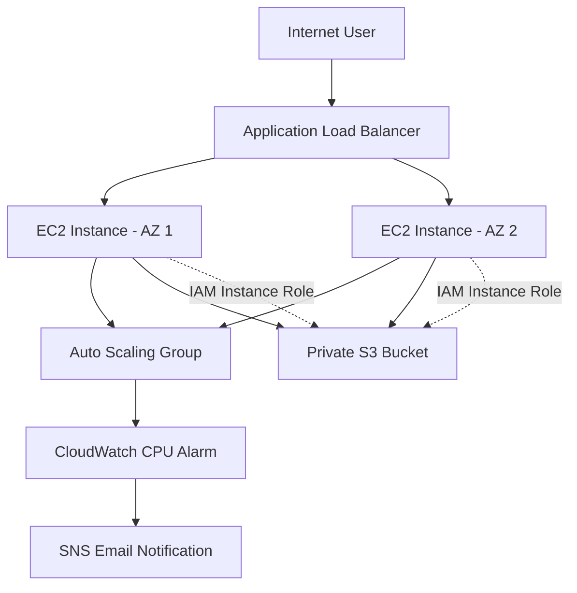

# AWS Cloud Foundations Capstone (CF01)

## 1. Project Overview

This project implements a highly available web application on AWS.

The objective was to deploy a web application across two Availability Zones, keep EC2 instances in private subnets, retrieve application content from a private S3 bucket using an IAM role, and monitor application infrastructure using CloudWatch and SNS.

The infrastructure was deployed in the AWS Ireland region (`eu-west-1`).

**Important:** The AWS infrastructure was successfully tested and then deleted as required by the lab teardown exercise. The screenshots in this repository provide evidence of the implementation, tests and cleanup.

## 2. Architecture

The solution uses the following AWS services:

- **Amazon VPC:** Provides network isolation.
- **Public subnets:** Host the Application Load Balancer.
- **Private subnets:** Host EC2 instances across two Availability Zones.
- **Application Load Balancer (ALB):** Receives HTTP traffic and distributes it to healthy EC2 instances.
- **EC2 Auto Scaling Group:** Maintains two application instances and replaces unhealthy or terminated instances.
- **Amazon S3:** Stores the application page in a private bucket.
- **IAM instance role:** Allows EC2 instances to retrieve the application file from S3 without storing access keys.
- **Security Groups:** Restrict traffic between the load balancer and application instances.
- **Amazon CloudWatch:** Monitors CPU utilisation and evaluates the alarm threshold.
- **Amazon SNS:** Sends email notifications when the alarm enters the ALARM state.

### Architecture diagram



## 3. Implementation and Verification

The following six requirements were implemented and tested.

| Requirement | Implementation and verification |
|---|---|
| 1. Application access | The application was accessed through the ALB DNS name. EC2 instances did not have public IP addresses. |
| 2. High availability | EC2 instances were deployed across two Availability Zones. One instance was terminated manually, and the Auto Scaling Group launched a replacement while the application remained available. |
| 3. Private S3 access | Application content was retrieved from S3 using an EC2 IAM role rather than stored access keys. |
| 4. S3 security | The S3 bucket was private, Block Public Access was enabled, and versioning was enabled. |
| 5. Network security | The application security group allowed HTTP traffic only from the ALB security group. |
| 6. Monitoring | A CloudWatch CPU alarm was configured with an SNS action. The alarm was tested and an email notification was received. |

## 4. Evidence Index

The following screenshots document the implementation and verification.

### Application access and high availability

| File | Evidence |
|---|---|
| `01-application-accessible-through-load-balancer.png` | Application accessed through the load balancer. |
| `02-ec2-instances-across-two-availability-zones.png` | EC2 instances deployed across two Availability Zones. |
| `03-ec2-instance-termination-test.png` | Manual EC2 instance termination test. |
| `04-auto-scaling-group-replacement-activity.png` | Auto Scaling Group replacement activity. |
| `05-auto-scaling-group-successfully-launches-replacement.png` | Successful replacement instance launch. |
| `06-application-available-after-instance-replacement.png` | Application availability after replacement. |

### S3 access and security

| File | Evidence |
|---|---|
| `07-iam-policy-for-private-s3-read-access.png` | IAM policy granting restricted S3 read access. |
| `08-ec2-launch-template-user-data.png` | Instance user data used to retrieve and serve application content. |
| `09-s3-block-public-access-enabled.png` | S3 Block Public Access configuration. |

### Network security and monitoring

| File | Evidence |
|---|---|
| `10-application-security-group-inbound-rules.png` | Application security group inbound rules. |
| `11-load-balancer-target-group-health-status.png` | Target group health status. |
| `12-cloudwatch-cpu-alarm-configuration.png` | CloudWatch CPU alarm configuration. |
| `13-cloudwatch-alarm-created.png` | Created CloudWatch alarm. |
| `14-cloudwatch-alarm-notification-test.png` | CloudWatch alarm notification test. |
| `15-sns-email-notification-received.png` | Received SNS email notification. |

### Teardown evidence

| File | Evidence |
|---|---|
| `16-teardown-load-balancers-empty.png` | Empty Load Balancers page after teardown. |
| `18-teardown-ec2-instances-empty.png` | Empty EC2 Instances page after teardown. |
| `19-teardown-s3-buckets-empty.png` | Empty S3 Buckets page after teardown. |

## 5. Well-Architected Review

The project review identifies three improvement opportunities across the AWS Well-Architected Framework:

1. **Security:** The ALB uses HTTP without HTTPS encryption in transit. An ACM certificate and HTTPS listener would improve security.
2. **Security:** The S3 bucket uses SSE-S3 encryption. SSE-KMS could provide additional control over encryption keys and key policies.
3. **Reliability:** The Auto Scaling Group uses fixed capacity rather than automatically adjusting capacity based on demand. Target tracking scaling could improve responsiveness.

See [17 - AWS Well-Architected Review](17-aws-well-architected-review.md) for the detailed findings, proposed remediations and trade-offs.

## 6. Teardown

After completing implementation and verification, the AWS resources created for this capstone were deleted.

The teardown included the Auto Scaling Group, load balancer, target group, launch template, S3 bucket, IAM resources, monitoring resources, security groups, VPC endpoint and VPC.

The empty EC2 Instances, Load Balancers and S3 Buckets pages were captured as evidence.

## 7. Repository Structure

```text
cloud foundation/
|
|-- README.md
|-- 01-application-accessible-through-load-balancer.png
|-- 02-ec2-instances-across-two-availability-zones.png
|-- ...
|-- 16-teardown-load-balancers-empty.png
|-- 17-aws-well-architected-review.md
|-- 18-teardown-ec2-instances-empty.png
|-- 19-teardown-s3-buckets-empty.png
```

This repository contains the capstone documentation and evidence. The AWS infrastructure itself has been torn down and is not currently running.
